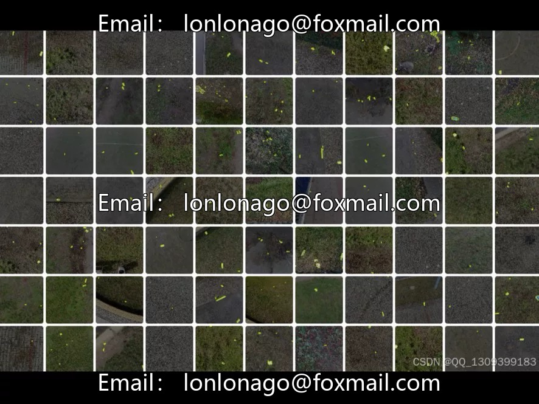
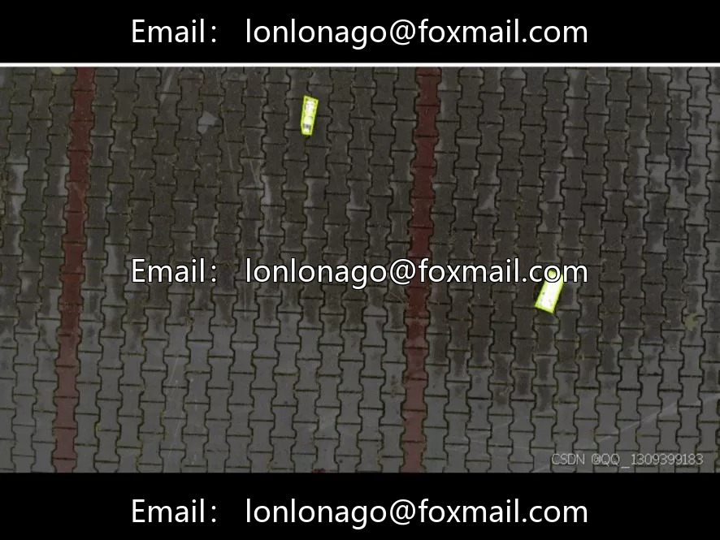
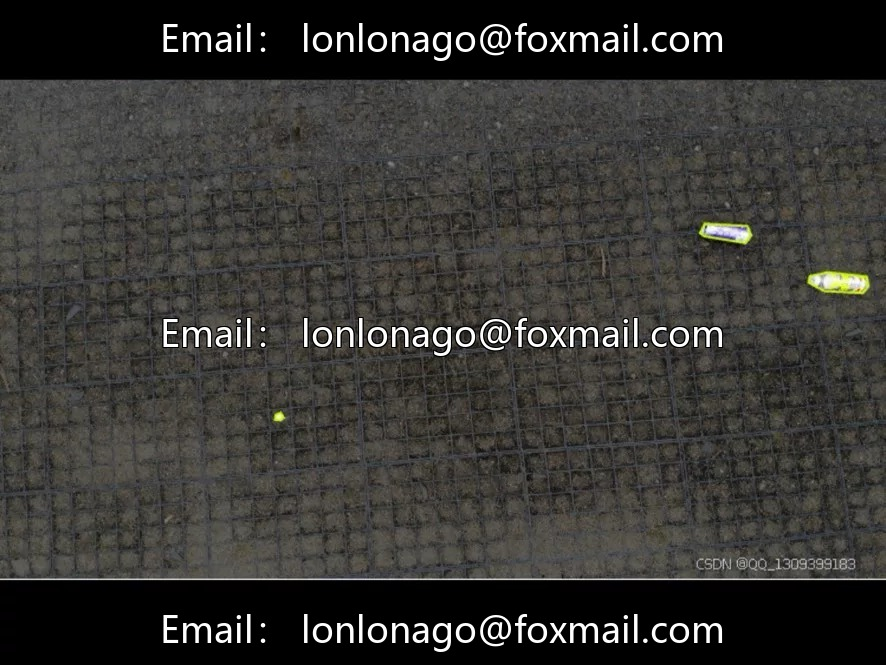
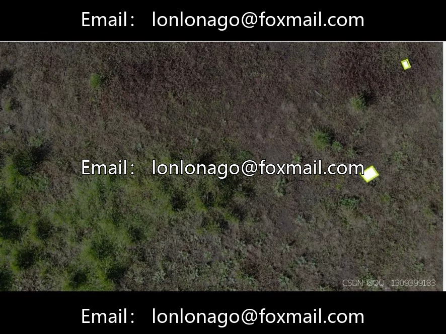

# Drone aerial photography inspection and waste identification segmentation dataset | Streets and Parks Waste Detection 10th

## Body

Drone aerial photography inspection and garbage recognition segmentation dataset | Streets and Parks Garbage Detection Issue No. 10098

The dataset contains 772 aerial images of drones, covering two categories: bottles and rubbish. The annotation format is compatible with mainstream object detection frameworks. It is suitable for basic tasks such as intelligent waste sorting and environmental sanitation monitoring.

The data size is moderate, suitable for small and medium-sized projects, student research, algorithm prototype development, preliminary model training and parameter tuning. It can provide a basic reference for subsequent expansion of data size.

Application scenarios: Smart waste classification equipment development, public area waste accumulation monitoring, drone sanitation inspection, target detection teaching demonstration. The annotation format supports rapid adaptation to mainstream frameworks.

Applicable Directions: Drone Urban Sanitation Patrol, Park/Street Garbage Automatic Identification, Recyclable Materials Classification and Pretreatment. Suitable for Smart Cities, Environmental Monitoring, Drone Patrol Projects

Virtual materials, once sold, are non-refundable.
Interested friends, click "I want" to proceed.

## Images

## Payment

Here is a pay link on Stripe ( https://buy.stripe.com/3cs8yP7sY87d0vu9AB ). Please contact me lonlonago@foxmail.com after funding $89, and I will send you a complete data files , thank you!

